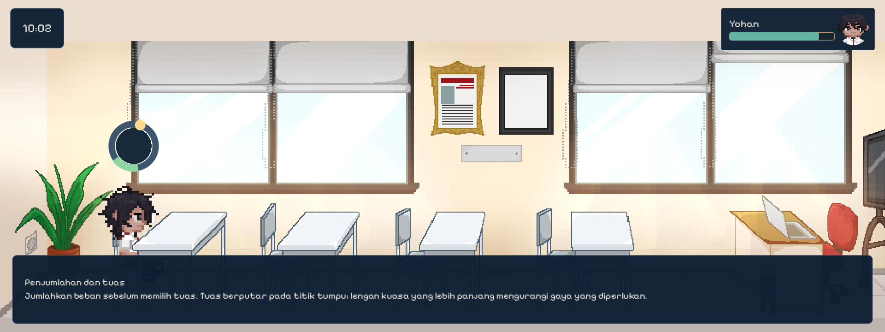
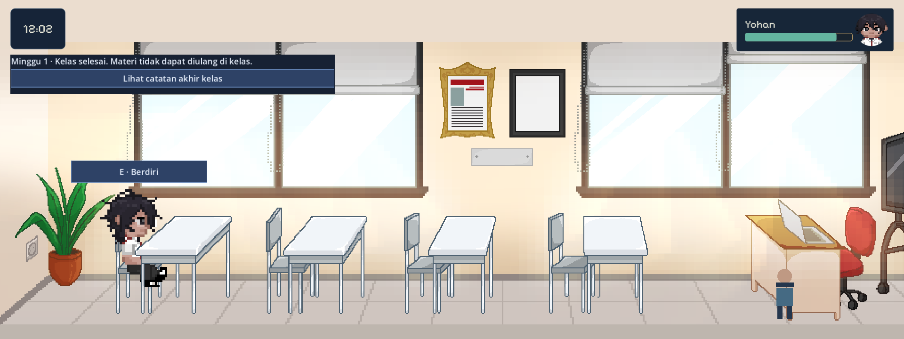

# Background kelas dan kursi

Background menggunakan Tak berjudul67_20261122185304.png yang tidak memuat meja/kursi mahasiswa. Meja terpisah memakai Tak berjudul67_20261122185226.png. Empat kursi memakai aset bernomor 581, 582, 583, dan 584 sesuai urutan kiri ke kanan. File disalin tanpa mengubah isi gambar ke assets/classroom. Rasio gambar dan susunan furnitur mengikuti referensi kelas sebelumnya.

Urutan tampilan pada canvas world: background z-index -1, kursi 0, MC 1, dan meja 2. Bubble interaksi memakai 3 agar tetap terbaca. Meja merupakan overlay transparan pada posisi (0, 80) dengan skala 0,9375, sama dengan background. Desks dan kursi interaktif tidak ditampilkan pada ruangan yang menonaktifkan kelas. Background sebelumnya dipertahankan untuk ruang lain yang memakai scene turunan.

Posisi interaksi kursi dari kiri ke kanan: x 266, 555, 820, dan 1095 pada world kelas. Kursi paling kanan (x 1095) ditempati Noc random kid dan tidak dapat dipakai pemain. Dosen berada di depan kelas. Ketiga kursi lainnya tetap dapat digunakan: dekati kursi, kemudian tekan E atau klik bubble. Pada minggu kuliah yang materinya belum selesai, pemain duduk dan memulai belajar/QTE. Setelah materi selesai atau pada minggu ujian, E hanya untuk duduk; E berikutnya atau bubble Berdiri mengembalikan gerak. Duduk biasa tidak membuka kembali materi dan tidak memulai QTE.

Sesudah belajar selesai, catatan akhir tetap ditampilkan untuk dibaca. Tombol Kembali ke lorong atau penutupan popup memicu fade dan mengembalikan pemain ke lorong pada lantai kelas tersebut. Catatan yang masih kosong tetap tersimpan. Membaca ulang catatan melalui tombol Review tidak memicu teleport.

MC memakai aset duduk Tak berjudul16_20261122191014.png saat duduk maupun belajar. Aset satu pose ini memakai animasi sit dengan gerak napas ringan, tanpa memipihkan sprite berdiri. Berdiri mengembalikan posisi sprite dan skala sebelumnya. Skala visual karakter disesuaikan khusus di kelas; posisi QTE mengikuti bagian atas sprite dan menampilkan tulisan SPACE di tengah lingkaran. Komputer ujian memakai laptop yang sudah tergambar pada meja dosen. Ruang lab tetap memakai background dummy.

Validasi khusus: tests/classroom_seating_smoke.gd menguji tiga kursi pemain melalui E, QTE saat duduk, penyelesaian materi satu kali, penguncian gerak, berdiri melalui bubble, duduk pada minggu ujian, dan ruang lab. Pengujian memakai save terisolasi. Opsi --capture menyimpan preview ke .godot/classroom-standing.png, .godot/classroom-seated.png, dan .godot/classroom-qte.png.

Uji terbaru classroom_seating_smoke dan npc_placement_smoke lulus. NPC muncul pada seluruh scene kelas, kursi yang ditempati menolak interaksi pemain, dan NPC lorong sesuai penempatan pengguna. Pemeriksaan grafis meliputi pose duduk, susunan furnitur, serta tulisan SPACE pada QTE. Perubahan masih lokal tanpa commit/push; build Windows belum diperbarui.

