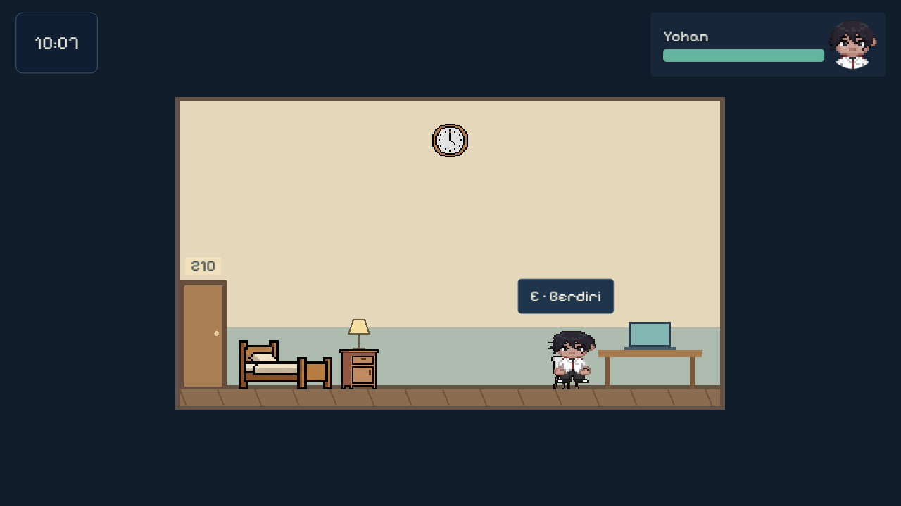

# Asrama dan kamar 210

Lantai 1 memiliki pintu bernomor 101–110. Lantai 2 memiliki pintu 201–210; pintu 210 berwarna hijau dan terhubung ke kamar pemain. Kamar lain terkunci dan memberi informasi saat diinteraksikan. Tangga naik tetap berada di kanan lantai 1; pintu tangga lantai 2 kembali ke lantai 1.

Kamar 210 memiliki world tersendiri tanpa objek kelas, kamera tetap, dan ukuran 60% lebar serta 60% tinggi viewport, berada di tengah layar. Dinding, langit-langit, dan lantai memiliki collision yang menyesuaikan ukuran jendela. Pemain tidak bisa bergerak keluar dari kamar.

| Berkas pengguna | Aset project | Pemakaian |
|---|---|---|
| Furniture (96).png | assets/furniture/dorm/bed.png | Kasur |
| Furniture (117).png | assets/furniture/dorm/nightstand.png | Nakas di samping kasur |
| Furniture (246).png | assets/furniture/dorm/chair.png | Kursi yang dapat diduduki |
| Furniture (105).png | assets/furniture/dorm/clock.png | Jam dinding |

Keempat PNG disalin tanpa perubahan byte dan ditampilkan menggunakan nearest filtering. Meja belajar, laptop, dan lampu nakas dibuat sebagai dummy melalui drawing Godot.

Dekati kursi, lalu tekan E untuk duduk. Gerakan terkunci selama duduk; E berikutnya membuat pemain berdiri kembali. Animasi dan skala berdiri dipulihkan setelah berdiri. Laptop tetap dapat diakses dengan E setelah berdiri dan mendekatinya; mematikan komputer mengembalikan pemain ke posisi meja dalam kamar. Interaksi tidur berada pada kasur.

Posisi pemain dalam save dinormalisasi terhadap ruang gerak kamar agar dapat dipulihkan pada resolusi lain. Save lama kamar tetap diterima. Pemain yang dimuat kembali dalam keadaan sebelumnya duduk dikembalikan ke posisi berdiri agar kontrol tidak terkunci.

Validasi: dorm_room_smoke memeriksa nomor kamar, keempat PNG, ukuran kamar pada 960×540, 1280×720, dan 1920×1080, empat collision batas, tombol E untuk duduk/berdiri, penguncian gerak, save/load lintas resolusi, serta keluar-masuk desktop. Suite produksi kini memiliki 18 pemeriksaan termasuk lima pengujian ulang dari proses baru. Tampilan kamar dan koridor juga diperiksa secara grafis.
